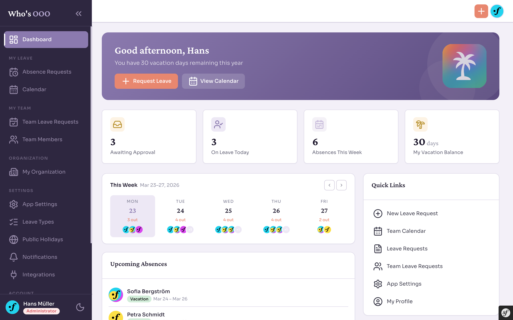

# Who's Out of Office

[](https://github.com/igornast/who-is-out-of-office/actions/workflows/php.yml)
[](https://codecov.io/gh/igornast/who-is-out-of-office)


Who's OOO is a self-hosted staff leave planner I built with Symfony 7.4 and PHP 8.5. It
handles leave requests, team calendars, public holidays and Slack notifications, and it runs on
your own server.

[www.whoisooo.app](https://www.whoisooo.app)



The idea is simple: employees request leave, managers approve or reject it, and admins look
after the rest. There are three roles (Admin, Manager and Employee), and approvals also work
straight from Slack. The same Slack app posts a weekly digest of who's out and can set people's
Slack status while they're away.

Public holiday calendars handle regional holidays too, so a team split across Bavaria and
Berlin gets the right days off. Every user gets a personal iCal feed, email notifications, and
optional two-factor authentication with TOTP and backup codes.

## Quick start

```bash
git clone https://github.com/igornast/who-is-out-of-office.git
cd who-is-out-of-office
just start
```

That's it. On first boot the PHP container installs dependencies, waits for the database, runs
migrations and loads the dev fixtures. Once it's done, the app is at
`http://localhost/app/dashboard`.

[CONTRIBUTING.md](CONTRIBUTING.md) covers the full setup and how to run the tests.

## Admin account

The dev fixtures include an admin account you can log in with:

- Email: `admin@whoisooo.app`
- Password: `123`

> [!IMPORTANT]
> This account only exists in development. Production never loads fixtures, so you create the
> first admin yourself. See
> [Create the first admin account](docs/production-deployment.md#4-create-the-first-admin-account).

## Production deployment

> [!WARNING]
> Never run the default `docker-compose.yml` against production data. It's the development
> stack, built to be thrown away: its entrypoint drops the database and reloads demo fixtures
> every time the container starts. The deployment guide explains
> [how to keep the two stacks apart](docs/production-deployment.md#keep-the-development-stack-away-from-production-data).

For production there's `docker-compose.prod.yml`. It builds the `prod` image, runs with
`APP_ENV=prod` and includes the background workers that send email and run scheduled jobs.
It serves plain HTTP, so you put your own TLS proxy in front of it.

The [production deployment guide](docs/production-deployment.md) walks through the whole
setup: configuration, the reverse proxy, creating the first admin, the workers and where App
Settings live. It also covers the less fun parts, like what to check before upgrading, backups,
and moving a dev install to production.

## Application settings

Admins change how the app behaves from the UI, with no code change or deploy. Settings are
stored in a YAML file. On the Docker production stack that file lives on a shared volume (see
[Application settings](docs/production-deployment.md#application-settings)).

| Setting | What it does |
|---|---|
| `leave_request.auto_approve` | Approve leave requests automatically |
| `leave_request.auto_approve_delay` | Minutes to wait before auto-approving |
| `leave_request.default_annual_allowance` | Annual leave days for new users |
| `leave_request.min_notice_days` | Minimum notice for a leave request, in days (0 means no minimum) |
| `leave_request.max_consecutive_days` | Maximum consecutive days per request (0 means unlimited) |
| `notification.skip_weekend_holidays` | Leave public holidays that fall on a weekend out of notifications |
| `slack.status_sync_enabled` | Turn Slack status sync on or off |
| `slack.weekly_digest_day`, `slack.weekly_digest_time`, `slack.weekly_digest_timezone` | When the Slack weekly digest is posted |
| `organization.name` | Your organization's display name |

To change them, log in as an admin, open App Settings in the sidebar, edit the values and
click Save Changes.

The file lives at `app/src/Module/Settings/Config/app_setting.yaml`. Set the
`APP_SETTINGS_FILE` environment variable to store it somewhere else.

The [Settings module README](app/src/Module/Settings/README.md) explains the architecture and
how to add a new setting.

## Public holiday import

Admins can import public holidays from the UI: open Public Holidays in the Settings section of
the sidebar, click Add Calendar, pick a country and year, and import.

The same import is available from the CLI:

```shell
php app/bin/console app:holiday:import DE Germany 2025
```

## Frontend and assets

The frontend uses Symfony AssetMapper and Symfony UX for JavaScript, CSS and components.

The production PHP container compiles assets each time it starts. If you deploy without
Docker, compile them yourself after each deploy:

```shell
php app/bin/console asset-map:compile
```

Source assets live in `assets/` and `importmap.php`. Remote packages such as Stimulus and the UX
components are resolved at compile time. Don't edit anything in `public/assets/`; it's
generated and your changes will be overwritten.

See the [AssetMapper](https://symfony.com/doc/current/frontend/asset_mapper.html) and
[Symfony UX](https://ux.symfony.com) docs for details.

## Slack integration

### Configuration

Set these variables in `app/.env.local` or in your server environment:

```dotenv
###> symfony/notifier ###
SLACK_DSN=""
SLACK_SIGNING_SECRET=""
# Channel where managers approve or reject leave requests
SLACK_AR_APPROVE_CHANNEL_ID=""
# Channel for the weekly digest
SLACK_AR_HR_DIGEST_CHANNEL_ID=""
###< symfony/notifier ###
```

The app posts to two channels. `SLACK_AR_APPROVE_CHANNEL_ID` gets every new leave request, with
buttons managers use to approve or reject it without leaving Slack.
`SLACK_AR_HR_DIGEST_CHANNEL_ID` gets the weekly digest.

Incoming requests from Slack are checked against `SLACK_SIGNING_SECRET`, so only your Slack app
can call the interactive endpoint. While the secret is empty, every request is rejected. The
check is in the `RequestVerifier` class in the Slack module.

### Bot setup

1. Create a Slack app and install it in your workspace. Grant the bot the `chat:write` scope,
   generate an OAuth token and put it in `SLACK_DSN`. Slack's
   [OAuth guide](https://api.slack.com/authentication/oauth-v2) has the details.
2. In the app settings, open Interactivity & Shortcuts and set the Request URL to:
   ```
   https://your-domain.com/api/slack/interactive-endpoint
   ```

### Approvals from Slack

When someone submits a leave request, the bot posts it to the approval channel with Approve and
Reject buttons. A manager's click sends a `block_actions` payload to the interactive endpoint.
The app verifies the Slack signature, reads the button's `value`, updates the leave request, and
edits the original Slack message to show the outcome.

Users who have added their Slack member ID to their profile and enabled the app in Slack also
get a direct message from the bot when their request is approved or rejected.

### Weekly digest

The `slack:weekly_digest` command posts a summary for the current week: who is out (leave and
public holidays), birthdays and work anniversaries. If there isn'thing to report, it posts a
short message saying so.

Admins set the day, time and timezone under App Settings. The job runs on its own Symfony
Scheduler schedule, `weekly_digest`, and picks up changes on the next scheduler tick without a
restart. The Docker production stack consumes both scheduler transports in `worker-scheduler`.
Without Docker, run:

```bash
php bin/console messenger:consume scheduler_default scheduler_weekly_digest
```

To post a digest by hand:

```bash
php bin/console slack:weekly_digest
```

### Slack status sync

While a user is on approved leave, the app can set their Slack status (emoji and text) and
clear it when the leave ends or is cancelled. This needs a paid Slack workspace, because free
plans don't allow setting another user's status.

#### How it works

The `slack:sync-statuses` command runs every 20 minutes. It sets the status for users whose
approved leave has started and hasn't been synced yet, for example "Vacation until Apr 18" with
the leave type's emoji. It clears the status for users whose leave has ended or was rejected or
withdrawn.

Each leave request carries an internal sync flag, so a status is never set twice and the
command catches up on its own after downtime.

#### Requirements

Besides the paid workspace, the Slack app needs an OAuth redirect URL that points to your
instance, and each user needs their Slack member ID in their profile.

#### Admin setup

1. Add these variables to `app/.env.local`:

   ```dotenv
   ###> app/slack-status-sync ###
   SLACK_CLIENT_ID="your-slack-app-client-id"
   SLACK_CLIENT_SECRET="your-slack-app-client-secret"
   SLACK_TOKEN_ENCRYPTION_KEY="base64-encoded-32-byte-key"
   ###< app/slack-status-sync ###
   ```

   Generate the encryption key with:

   ```bash
   php -r "echo base64_encode(sodium_crypto_secretbox_keygen());"
   ```

   The key encrypts the admin's OAuth token at rest. Keep it secret. If you change it, you have
   to authorize status sync again.

2. In the Slack app settings, add this OAuth redirect URL:
   ```
   https://your-domain.com/app/settings/slack-status-sync/oauth/callback
   ```

3. Under OAuth & Permissions → User Token Scopes, add the `users.profile:write` scope.

   > [!IMPORTANT]
   > Adding a scope means reinstalling the Slack app in your workspace. That issues a new Bot
   > User OAuth Token, so update `SLACK_DSN` in production afterwards.

4. Log in as an admin and open Settings → Integrations.

5. Click Authorize status sync. Slack asks you to grant permission; the admin doing this must be
   an Owner or Admin of the Slack workspace.

6. Once authorized, the status reads "Active" and sync starts.

#### Leave type emojis

Each leave type can have its own Slack emoji, such as `:palm_tree:` or
`:face_with_thermometer:`. Set it in the "Slack status emoji" field under Leave Types → Edit.
Leave it blank and you get `:calendar:`.

#### User opt-out

Users can turn status sync off for their own account in Profile Settings. The toggle is in the
Slack member ID dialog and shows up as soon as an admin turns on Slack status sync in App
Settings, even before anyone has authorized it. Statuses only change once it is authorized.

#### Revoking access

An admin can revoke the authorization at any time with Revoke authorization on the Status Sync
card under Settings → Integrations. That turns the feature off for everyone at once. If the
admin's token stops working (say, the person who authorized it was removed from Slack), the app
notices and turns the feature off by itself.

## Contributing

Contributions are welcome. [CONTRIBUTING.md](CONTRIBUTING.md) covers setup, coding standards
and how to submit changes.

Who's OOO is open source and free to self-host. If it's useful to you, a star on GitHub helps
other people find it.

## License

[AGPL-3.0](LICENSE)
